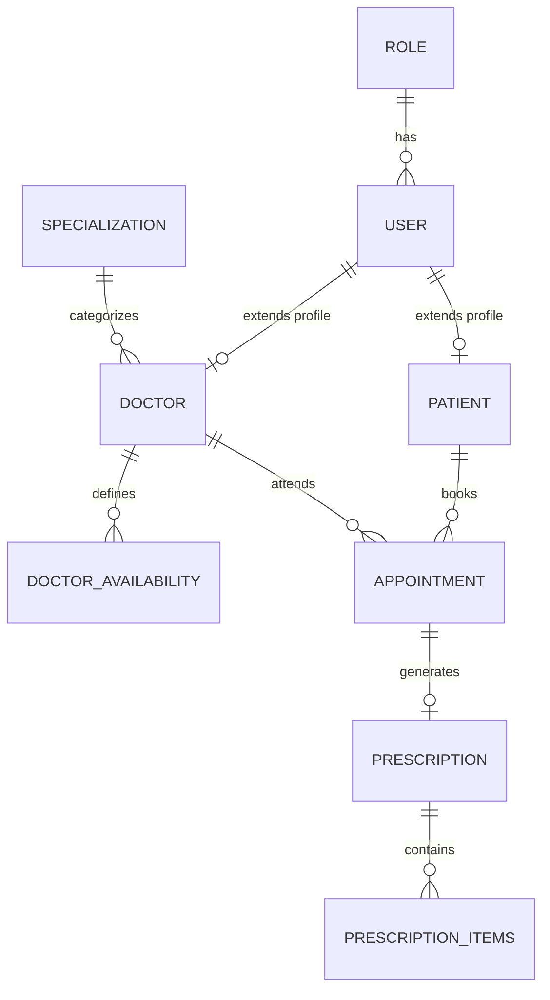

# 🏥 MediCare - Hospital & Clinic Management Backend API

[](https://nodejs.org/)
[](https://expressjs.com/)
[](https://www.mongodb.com/)
[](https://jwt.io/)
[](https://www.postman.com/)

A production-ready, scalable **Hospital & Clinic Management REST API** built with **Node.js, Express.js, and MongoDB**. Designed using clean **MVC (Model-View-Controller)** architecture, this system streamlines clinical workflows, appointment scheduling with collision prevention, multi-role authentication (RBAC), and prescription verification lifecycles.

---

## 📑 Table of Contents

- [Key Features](#-key-features)
- [System Architecture](#-system-architecture)
- [Tech Stack](#-tech-stack)
- [Database Models & Entity Relations](#-database-models--entity-relations)
- [API Endpoints Summary](#-api-endpoints-summary)
- [Getting Started](#-getting-started)
  - [Prerequisites](#prerequisites)
  - [Installation & Setup](#installation--setup)
  - [Environment Variables](#environment-variables)
- [Postman Testing & API Collection](#-postman-testing--api-collection)
- [Folder Structure](#-folder-structure)
- [Future Roadmap](#-future-roadmap)
- [Author & Acknowledgments](#-author--acknowledgments)

---

## 🚀 Key Features

### 🔐 1. Role-Based Access Control (RBAC) & Authentication
- Secure **JWT (JSON Web Token)** authentication with encrypted passwords via **Bcrypt** (10 salt rounds).
- Dynamic, reusable **`roleMiddleware`** enforcing granular access for `admin`, `doctor`, and `patient`.
- Atomic user onboarding: automatically creates linked **Doctor** or **Patient** profiles in a single registration request.

### 📅 2. Collision-Proof Appointment Scheduling
- Prevents race conditions and double-bookings using a unique composite **`bookingKey`** per doctor-slot.
- Context-aware query filtering:
  - **Patients** see only their personal appointments.
  - **Doctors** see only consultations assigned to them.
  - **Admins** have 360-degree visibility over all hospital appointments.

### 🩺 3. Doctor Availability & Specialization Engine
- Doctors can manage weekly recurring availability windows (`dayOfWeek`, `startTime`, `endTime`).
- Doctor profiles linked to medical specializations (e.g., Cardiology, Neurology, Orthopedics).

### 📝 4. Multi-Stage Prescription Approval Workflow
- **Doctor Creation**: Doctors draft prescriptions against verified appointments (initial status: `pending`).
- **Admin Verification**: Admins review, approve, or reject prescriptions with mandatory administrative remarks.
- **Prescription Items**: Linked granular medicine prescriptions including medicine name, dosage instructions, duration, and clinical notes.

### 📁 5. Multer File Uploads
- Dedicated disk storage engines for doctor and patient avatar uploads under `/uploads`.

---

## 🏗️ System Architecture

The project follows the standard **MVC (Model-View-Controller)** pattern for scalability, maintainability, and clean separation of concerns:

```
                  ┌───────────────────────────────┐
                  │          Client / UI          │
                  └──────────────┬────────────────┘
                                 │ HTTP Requests (Bearer JWT)
                                 ▼
                  ┌───────────────────────────────┐
                  │    Express Routing Layer      │
                  │       (routers/*.js)          │
                  └──────────────┬────────────────┘
                                 │
                  ┌──────────────▼────────────────┐
                  │   Auth & RBAC Middleware      │
                  │   (auth.middleware.js)        │
                  └──────────────┬────────────────┘
                                 │
                  ┌──────────────▼────────────────┐
                  │      Controller Layer         │
                  │     (controllers/*.js)        │
                  └──────────────┬────────────────┘
                                 │
                  ┌──────────────▼────────────────┐
                  │        Mongoose Models        │
                  │         (models/*.js)         │
                  └──────────────┬────────────────┘
                                 │
                  ┌──────────────▼────────────────┐
                  │        MongoDB Atlas          │
                  └───────────────────────────────┘
```

---

## 💻 Tech Stack

- **Runtime**: [Node.js](https://nodejs.org/) (v18+)
- **Framework**: [Express.js](https://expressjs.com/) (v4.x)
- **Database**: [MongoDB Atlas](https://www.mongodb.com/) via [Mongoose ODM](https://mongoosejs.com/)
- **Security**: [jsonwebtoken (JWT)](https://www.npmjs.com/package/jsonwebtoken), [bcrypt](https://www.npmjs.com/package/bcrypt)
- **File Uploads**: [Multer](https://www.npmjs.com/package/multer)
- **Environment**: [dotenv](https://www.npmjs.com/package/dotenv)

---

## 🗄️ Database Models & Entity Relations



---

## 📡 API Endpoints Summary

Base URL: `http://localhost:8000/api`

### 1. User & Authentication (`/user`)
| Method | Endpoint | Access Level | Description |
| :--- | :--- | :--- | :--- |
| `POST` | `/user/register` | Public | Register new user (Admin / Doctor / Patient) |
| `POST` | `/user/login` | Public | Authenticate user & generate JWT token |
| `GET` | `/user/me` | Authenticated | Fetch logged-in user profile |
| `GET` | `/user/fetch` | Admin | Fetch all registered users |
| `GET` | `/user/fetch/:id` | Admin | Fetch single user by ID |
| `PUT` | `/user/edit/:id` | Admin | Update user details |
| `DELETE` | `/user/delete/:id` | Admin | Delete user account |

### 2. Roles (`/role`)
| Method | Endpoint | Access Level | Description |
| :--- | :--- | :--- | :--- |
| `POST` | `/role/create` | Admin | Create a new role (`admin`, `doctor`, `patient`) |
| `GET` | `/role/fetch` | Admin | List all roles |
| `PUT` | `/role/edit/:id` | Admin | Update role details |
| `DELETE` | `/role/delete/:id` | Admin | Delete a role |

### 3. Specialization (`/specialization`)
| Method | Endpoint | Access Level | Description |
| :--- | :--- | :--- | :--- |
| `POST` | `/specialization/register` | Public / Admin | Create a medical specialization |
| `GET` | `/specialization/fetch` | Public | List all specializations |
| `GET` | `/specialization/fetch/:id` | Public | Get single specialization details |
| `PUT` | `/specialization/edit/:id` | Public / Admin | Edit specialization |
| `DELETE` | `/specialization/delete/:id` | Public / Admin | Delete specialization |

### 4. Doctors (`/doctor`)
| Method | Endpoint | Access Level | Description |
| :--- | :--- | :--- | :--- |
| `POST` | `/doctor/register` | Admin, Doctor | Register doctor profile (with avatar upload) |
| `POST` | `/doctor/login` | Public | Direct doctor login |
| `GET` | `/doctor/fetch` | Public | Get all doctor profiles |
| `GET` | `/doctor/fetch/:id` | Public | Get doctor profile by ID |
| `PUT` | `/doctor/edit/:id` | Admin, Doctor | Update doctor profile |
| `DELETE` | `/doctor/delete/:id` | Admin | Delete doctor profile |

### 5. Doctor Availability (`/doctor-availability`)
| Method | Endpoint | Access Level | Description |
| :--- | :--- | :--- | :--- |
| `POST` | `/doctor-availability/register` | Admin, Doctor | Add slot availability window |
| `GET` | `/doctor-availability/fetch` | Public | List availability (supports filter queries) |
| `GET` | `/doctor-availability/fetch/:id`| Public | Fetch single availability record |
| `PUT` | `/doctor-availability/edit/:id` | Admin, Doctor | Edit doctor availability |
| `DELETE` | `/doctor-availability/delete/:id`| Admin, Doctor | Delete availability window |

### 6. Patients (`/patient`)
| Method | Endpoint | Access Level | Description |
| :--- | :--- | :--- | :--- |
| `POST` | `/patient/register` | Admin, Doctor, Patient | Register patient profile |
| `POST` | `/patient/login` | Public | Direct patient login |
| `GET` | `/patient/fetch` | Admin | List all patients |
| `GET` | `/patient/fetch/:id` | Admin | Fetch patient details |
| `PUT` | `/patient/edit/:id` | Admin, Patient | Update patient profile |
| `DELETE` | `/patient/delete/:id` | Admin | Remove patient profile |

### 7. Appointments (`/appointment`)
| Method | Endpoint | Access Level | Description |
| :--- | :--- | :--- | :--- |
| `POST` | `/appointment/register` | Admin, Doctor, Patient | Book new appointment (with collision check) |
| `GET` | `/appointment/fetch` | Admin, Doctor, Patient | Get filtered appointments by user role |
| `GET` | `/appointment/fetch/:id` | Admin, Doctor, Patient | Get appointment details |
| `PUT` | `/appointment/edit/:id` | Admin, Doctor | Reschedule / Update appointment status |
| `DELETE` | `/appointment/delete/:id` | Admin, Doctor | Cancel / Delete appointment |

### 8. Prescriptions & Items (`/prescription`, `/prescription-items`)
| Method | Endpoint | Access Level | Description |
| :--- | :--- | :--- | :--- |
| `POST` | `/prescription/create` | Admin, Doctor | Create draft prescription (`pending`) |
| `GET` | `/prescription/fetch` | Admin, Doctor, Patient | Fetch prescriptions (filter by status) |
| `GET` | `/prescription/fetch/:id`| Admin, Doctor, Patient | Fetch single prescription |
| `PUT` | `/prescription/approval/:id` | Admin | Approve or reject prescription |
| `POST` | `/prescription-items/create` | Admin, Doctor | Add medicine item to prescription |
| `GET` | `/prescription-items/fetch/:prescriptionId` | Admin, Doctor, Patient | Get all medicines for a prescription |

---

## ⚡ Getting Started

### Prerequisites
- [Node.js](https://nodejs.org/) (v18.x or higher)
- [MongoDB Atlas](https://www.mongodb.com/) cluster or local MongoDB instance
- [Postman](https://www.postman.com/) (for testing)

### Installation & Setup

1. **Clone the repository**:
   ```bash
   git clone https://github.com/your-username/hospital-management-api.git
   cd hospital-management-api
   ```

2. **Install dependencies**:
   ```bash
   npm install
   ```

3. **Configure Environment Variables**:
   Create a `.env` file in the root directory:
   ```env
   PORT=8000
   MONGO_URL=mongodb+srv://<username>:<password>@cluster.mongodb.net/<dbname>
   JWT_SECRET=your_super_secret_jwt_key
   ```

4. **Start the Development Server**:
   ```bash
   npm start
   # or
   node server.js
   ```
   Server will start running at: `http://localhost:8000`

---

## 📮 Postman Testing & API Collection

A fully configured **Postman Collection v2.1.0** is included directly in the root of this project:
📄 **`Postman_Collection.json`**

### How to use:
1. Open **Postman**.
2. Click **Import** (top left) and select the `Postman_Collection.json` file.
3. Set your collection variable `baseUrl` to `http://localhost:8000/api`.
4. Run the **User -> Login User** request to copy the token, set it in the `token` variable, and test any endpoint with 1-click!

---

## 📂 Folder Structure

```
node-project/
├── config/
│   └── db.js                        # MongoDB Mongoose connection
├── controllers/
│   ├── appointment/                 # Appointment logic & conflict checks
│   ├── doctors/                     # Doctor & Availability controllers
│   ├── patients/                    # Patient profiles controller
│   ├── prescription/                # Prescription & Medicine item logic
│   ├── roles/                       # Roles controller
│   ├── specialization/              # Specializations controller
│   └── user/                        # Authentication & User controllers
├── middleware/
│   ├── auth/
│   │   └── auth.middleware.js       # JWT validation & RBAC middleware
│   └── multer/
│       └── multer.js                # DiskStorage for image uploads
├── models/
│   ├── appointment/                 # Appointment Mongoose schema
│   ├── doctors/                     # Doctor & Availability schemas
│   ├── patient/                     # Patient schema
│   ├── prescription_items/          # Prescription & Item schemas
│   ├── roles/                       # Role schema
│   ├── specializations/             # Specialization schema
│   └── user/                        # User schema
├── routers/
│   ├── appointment/
│   ├── doctors/
│   ├── patient/
│   ├── prescription/
│   ├── roles/
│   ├── specialization/
│   ├── user/
│   └── index.router.js              # Centralized route aggregator
├── uploads/                         # Uploaded avatars (Doctors & Patients)
├── .env                             # Environment configuration
├── package.json                     # Project manifest & dependencies
├── Postman_Collection.json          # Pre-built Postman Collection
├── README.md                        # Documentation
└── server.js                        # Application entry point
```

---

## 🔮 Future Roadmap

- [ ] **React / Next.js Admin & Patient Portal**: Interactive frontend dashboard.
- [ ] **Payment Gateway Integration**: Razorpay / Stripe for online consultation fee settlement.
- [ ] **Real-time Notifications**: Socket.io for immediate appointment updates and doctor alerts.
- [ ] **Email & SMS Reminders**: Automated reminders via Nodemailer / Twilio before scheduled appointments.
- [ ] **Docker Containerization**: Dockerfile and docker-compose for rapid cloud deployment.

---

## 👨‍💻 Author & Acknowledgments

- **Developer**: Vivek Gautam
- **GitHub**: [devvivekgautam-coder](https://github.com/your-username)
- **LinkedIn**: [https://www.linkedin.com/in/vivek-gautam-2737a7367/](https://linkedin.com/in/your-profile)

If you found this project helpful, please give it a ⭐️ on GitHub!
